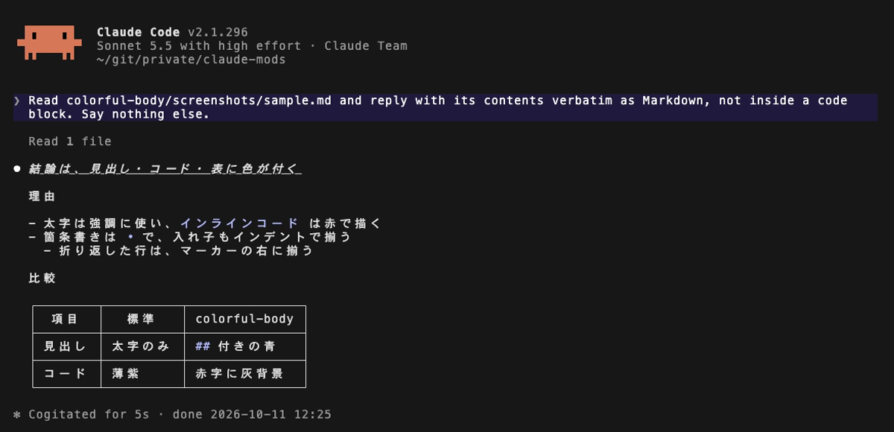
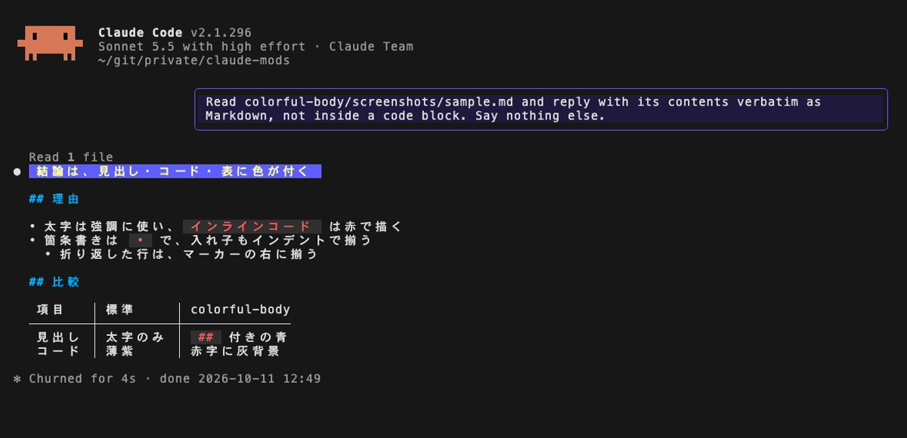

# colorful-body

Claude の応答本文を、Markdown ビューア [glow](https://github.com/charmbracelet/glow) のような見た目で描く。
見出し・インラインコード・箇条書き・表に色が付き、あなたの発言は右寄せの枠で囲まれる。

標準の描画（mod なし）:

colorful-body:

- ターミナルのみ（Claude Code 2.1.296 で確認）
- 描画だけを変える。会話の履歴は書き換えず、通信もファイルの読み書きもしない

## 見た目

| 要素 | 変わり方 |
| --- | --- |
| `#` 見出し | 黄文字・青紫背景のバッジ |
| `##` 以降の見出し | `##` 付きの青い太字 |
| インラインコード | 赤字・灰背景 |
| 箇条書き | `•` |
| 表 | `─┼─` と `│` で区切る。狭いときはセル内で折り返す |
| あなたの発言 | 右寄せの枠で囲む |

## 設定

`/config` の colorful-body の欄で変えられる。

| 項目 | 内容 | 既定 |
| --- | --- | --- |
| `frame` | あなたの発言を右寄せの枠で囲む。オフでは標準の描画 | オン |
| `links` | URL とパスらしいインラインコードを、下線付きのリンクにする | オフ |

`links` は、OSC 8 ハイパーリンクに対応した端末でだけオンにする。対応していない端末では URL が二重に出て、クリックしても開かない。
まず 1 つの URL で、下線だけが付くことと、クリックで開くこと（多くの端末では Cmd/Ctrl+クリック）を確かめるとよい。

## 注意

- 長い `#` 見出しは、折り返して読みにくくなる
- 端末の全角・絵文字の幅の数え方が違うと、表の罫線や枠が数桁ずれる
- 太字とインラインコードは、行をまたぐと色が付かず文字のまま出る

開発者向けの情報は [DEVELOPMENT.md](DEVELOPMENT.md)。
